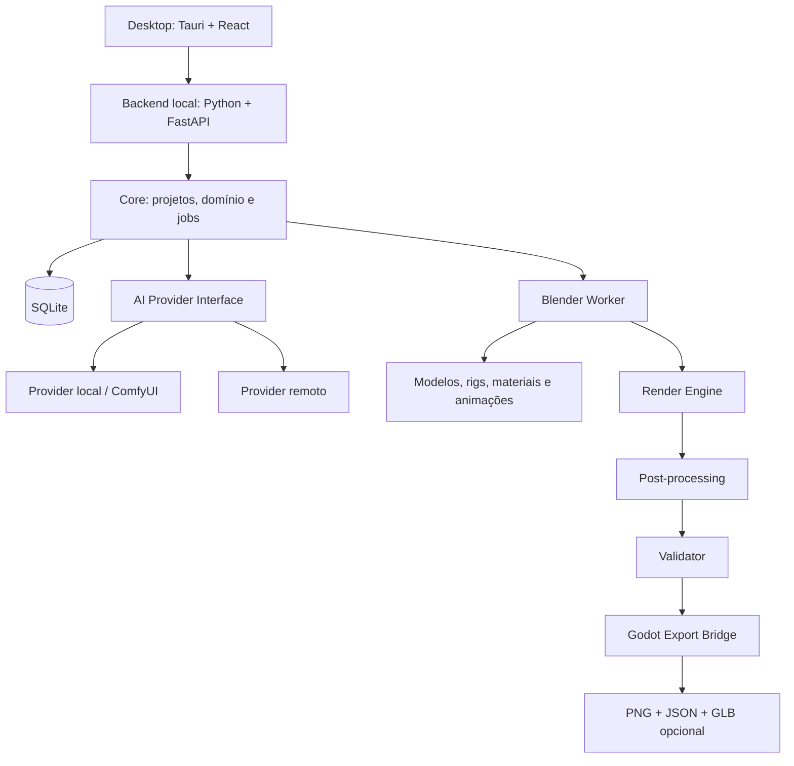

# 04 — Arquitetura técnica

## 1. Visão geral

A arquitetura será local-first e modular. O aplicativo desktop apresenta a interface; um backend local coordena projetos e jobs; o Blender executa operações 3D em processos controlados; providers de IA são adaptadores opcionais; o Exporter produz pacotes independentes do motor de jogo.

## 2. Stack recomendada

| Camada | Tecnologia | Motivo/uso |
|---|---|---|
| Desktop shell | Tauri 2 | Aplicativo desktop e integração com sistema operacional |
| UI | React + TypeScript | Interface e componentes visuais |
| Backend local | Python + FastAPI | Orquestração e APIs locais |
| Contratos | Pydantic | Validação de dados Python |
| Banco | SQLite | Metadados e estado local no MVP |
| 3D | Blender | Montagem, rigging, animação e renderização |
| Automação 3D | Blender Python API | Scripts e cenas reproduzíveis |
| Imagens | Pillow ou biblioteca equivalente | Recorte, atlas e metadados de imagem |
| IA | Adaptadores intercambiáveis | Provedores locais ou remotos |
| Integração de jogo | Godot 4 | Primeiro consumidor dos assets |

Essas escolhas são recomendações para prototipação e devem ser confirmadas por uma prova de conceito. A arquitetura não deve acoplar regras de domínio a uma tecnologia específica.

## 3. Processo desktop/backend

Proposta para o MVP:

- Tauri inicia e supervisiona o backend local como processo auxiliar;
- backend escuta somente em loopback (`127.0.0.1`), em porta escolhida dinamicamente;
- aplicação usa token de sessão local ou mecanismo equivalente para autenticar chamadas;
- Tauri controla inicialização, encerramento e detecção de falha do backend;
- backend cria e supervisiona processos Blender;
- logs são associados ao projeto e ao `job_id`.

Não expor a API local à rede por padrão. Não confiar em uma porta fixa sem mecanismo de verificação de processo/autenticação.

## 4. Limites de responsabilidade

### Desktop/UI

- apresentação de dados;
- edição visual de configurações;
- submissão de comandos;
- exibição de preview, progresso e erros.

Não deve conter lógica de montagem 3D nem regras de compatibilidade de rigs.

### Backend/Core

- domínio de projetos e personagens;
- validação de contratos;
- orquestração de jobs;
- persistência;
- rastreabilidade;
- gerenciamento de dependências entre etapas.

### Blender Worker

- carregar templates;
- montar modelos a partir de componentes;
- configurar materiais, rig e animações;
- posicionar câmeras;
- renderizar frames;
- gravar resultados e logs.

O Blender deve ser executado como processo separado. Isso isola falhas e permite reiniciar workers sem derrubar a interface.

### AI Provider

- receber tarefas de IA bem delimitadas;
- devolver resultado estruturado ou referência de imagem;
- registrar modelo, parâmetros e versão;
- nunca alterar projetos silenciosamente.

### Exporter

- organizar arquivos;
- montar atlases quando configurado;
- emitir metadados;
- validar correspondência entre manifesto e arquivos;
- empacotar integração de destino.

## 5. Comunicação entre módulos

Preferir contratos explícitos e operações idempotentes sempre que possível.

Exemplos de comandos de domínio:

- `create_project`
- `create_character`
- `validate_character_spec`
- `generate_concept`
- `approve_concept`
- `build_character`
- `apply_animation_profile`
- `render_character`
- `validate_render_output`
- `export_character`

Cada operação longa deve gerar um `GenerationJob` ou job equivalente, com estado persistido.

## 6. Persistência

SQLite armazenará, inicialmente:

- projetos;
- personagens;
- revisões;
- jobs e estados;
- configurações;
- referências a arquivos;
- histórico de exportação.

Os arquivos pesados ficarão no sistema de arquivos, não dentro do banco. O banco guardará caminhos relativos, hashes e metadados.

## 7. Processamento e fila

No MVP, uma fila persistida simples é suficiente. Limitar concorrência de processos Blender conforme CPU, RAM e GPU disponíveis.

Redis, filas distribuídas ou serviços de renderização remotos não fazem parte do MVP. Reavaliar apenas quando métricas demonstrarem necessidade.

## 8. Logs e observabilidade

Todo job deverá registrar:

- `job_id`;
- `project_id` e `character_id`;
- etapa atual;
- timestamps;
- parâmetros e versões relevantes;
- caminho dos logs do Blender;
- arquivos de entrada e saída;
- erro técnico e mensagem amigável.

## 9. Estratégia de testes

- testes unitários para contratos e regras de domínio;
- testes de integração para backend e banco;
- testes de automação Blender em cenas pequenas;
- testes de render com fixtures conhecidas;
- testes de exportação e importação no Godot;
- testes end-to-end do vertical slice.

## 10. Decisões arquiteturais a validar

- mecanismo definitivo para empacotar Python/backend como sidecar do Tauri;
- compatibilidade de versões Blender/Godot;
- biblioteca de pós-processamento de imagem;
- sistema de autenticação local entre UI e backend;
- forma de instalação e atualização do Blender e de seus assets.

## 11. Adendo de 2026-11-07: evolução para Procedural Art Engine

As responsabilidades da fundação gráfica moram nos componentes que já existem; não se cria um módulo por item:

| Responsabilidade | Onde mora |
|---|---|
| Coordenadas e projeção | `backend/app/domain/directions.py`, `RenderProfile` |
| Geometria e forma | `blender/scripts/ics_blender/geometry.py`, geradores `chibi_*`, `chibi_detail.py` |
| Materiais | `ArtProfile` (papéis de material) + `materials.py` |
| Luz e sombra | `scene.add_lights` + passes de luz com sombra projetada |
| Câmera | `scene.add_camera`, `camera_basis` |
| Composição e rasterização | `stage_pixel_passes.py` (passes nativos) + `engines/postprocess_engine` (`pixel.py`, `smooth.py`) |
| Inspeção de qualidade | Gates do `pipeline.py` + sondas `scripts/master_audit_*` |
| Cache | `pipeline._stage` (hash de conteúdo) |
| Exportação | `engines/export_engine` |

Os acabamentos são ramos da etapa de render, escolhidos pelo perfil de arte:
- **toon** com casca 3D (legado);
- **pixel** (opcional);
- **smooth** (principal).

Os três consomem os mesmos passes e entregam o mesmo formato de quadro.

Os geradores especializados (personagem, criatura, natureza, objeto, construção, ambiente, material) entram como novos `generator` na biblioteca e novos estágios de build. Só o de personagem existe hoje.

A geração é **offline**. O Godot e a Pindorama Engine recebem quadros, atlas e metadados; em runtime cabe só o que for barato, como composição, variação simples e efeitos.
