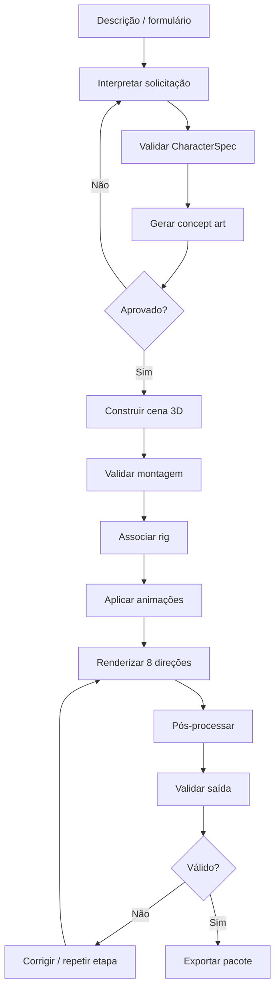

# 07 — Pipeline de geração

## 1. Visão do fluxo

## 2. Etapas detalhadas

### Etapa 1 — Entrada

Receber prompt, formulário ou seleção manual. Armazenar entrada original para rastreabilidade.

### Etapa 2 — Interpretação

A IA propõe um `CharacterSpec`. O sistema valida tipos, IDs, enums, compatibilidade e campos obrigatórios. Campos incertos devem ser marcados para revisão.

### Etapa 3 — Concept art

Gerar uma ou mais referências visuais. Registrar provider, modelo, parâmetros, data, licença/termos aplicáveis e referência ao arquivo.

### Etapa 4 — Aprovação

O usuário aprova o conceito ou solicita alterações. O sistema deve bloquear a revisão aprovada para que a construção use a mesma versão.

### Etapa 5 — Construção

O Blender Worker abre o template da família, instancia peças e materiais, aplica escalas/ancoragens e salva o `.blend` de origem.

### Etapa 6 — Rigging

Associar o modelo ao rig compatível. Validar ossos e deformações essenciais.

### Etapa 7 — Animação

Aplicar clips compatíveis. Criar preview e validar intervalo, loop e posição inicial.

### Etapa 8 — Renderização

Executar cada animação nas oito direções e salvar os frames em diretórios temporários identificados pelo job.

### Etapa 9 — Pós-processamento

Validar canal alpha, canvas, enquadramento e pivô. Gerar atlas e mapas de frames conforme o perfil.

### Etapa 10 — Validação

Executar testes automáticos e gerar relatório. Avisos artísticos devem ser apresentados para revisão humana.

### Etapa 11 — Exportação

Copiar apenas os arquivos aprovados para o pacote final e gerar manifest com hashes.

## 3. Estados do job

Estados sugeridos:

- `QUEUED`;
- `RUNNING`;
- `WAITING_REVIEW`;
- `SUCCEEDED`;
- `FAILED`;
- `CANCELLED`.

O estágio deve ser armazenado separadamente do estado global, por exemplo `SPEC_VALIDATION`, `CONCEPT`, `BUILD`, `RIG`, `ANIMATION`, `RENDER`, `POST_PROCESS`, `VALIDATION` e `EXPORT`.

## 4. Retomada e idempotência

- Cada etapa recebe inputs versionados e escreve em diretório próprio do job.
- Uma etapa concluída gera manifesto de saída.
- Repetir uma etapa com os mesmos inputs pode reutilizar cache quando hashes e versões coincidirem.
- Falha não deve sobrescrever exportações aprovadas.
- Cancelamento deve interromper processos filhos de forma controlada.
- A recuperação após encerramento inesperado deve consultar estado persistido e manifests existentes.

## 5. Regeneração seletiva

Exemplos:

| Alteração | Etapas potencialmente afetadas |
|---|---|
| Trocar cor/material | Materiais e render |
| Trocar cabelo | Montagem, validação e render; rig pode depender do componente |
| Trocar roupa | Montagem, validação, possivelmente rig/deformação, animação e render |
| Alterar câmera | Render e pós-processamento |
| Alterar FPS ou frames | Animação/render e exportação |
| Alterar metadados de exportação | Exportação |

A invalidação deve ser determinada por dependências explícitas, não por regras dispersas na interface.

## 6. Diretórios temporários

Cada job deverá ter pasta isolada. Só mover outputs para o diretório de exportação final depois de validação bem-sucedida.
