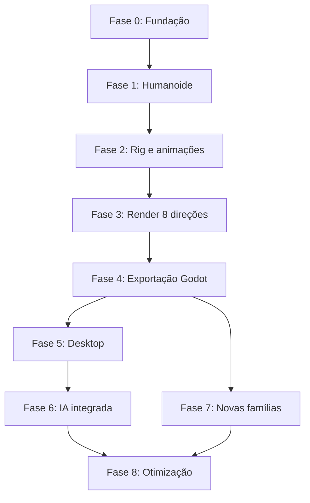

# 11 — Roadmap de implementação

## Estratégia

Implementar um vertical slice funcional antes de expandir a interface e o número de famílias. Cada fase precisa produzir uma entrega executável e critérios de aceite verificáveis.

## Fase 0 — Fundação técnica

**Objetivo:** provar a cadeia desktop/backend/Blender/Godot em escala mínima.

Entregas:
- repositório e convenções;
- projeto de backend local;
- contratos iniciais;
- execução Blender por processo;
- uma cena de teste com render;
- importação de um PNG no projeto Godot de teste;
- logs e relatório básico.

Saída obrigatória: comando automatizado produz uma imagem com transparência e o projeto Godot consegue importá-la.

## Fase 1 — Primeiro humanoide

Entregas:
- corpo base;
- cabeça e cabelo;
- peças de roupa;
- acessórios;
- materiais;
- pontos de ancoragem;
- montagem via `CharacterSpec`.

Saída obrigatória: três variações visuais a partir da mesma família de componentes.

## Fase 2 — Rig e animações

Entregas:
- rig humanoide;
- validação de hierarquia;
- idle, walk e run;
- preview de animação;
- configuração de FPS e loop.

Saída obrigatória: um personagem completo reproduz as três animações sem deformações críticas.

## Fase 3 — Renderizador isométrico

Entregas:
- `RenderProfile`;
- câmera ortográfica;
- convenção de oito direções;
- iluminação padronizada;
- canvas e pivô fixos;
- render batch.

Saída obrigatória: oito vistas por animação, sem espelhamento artificial e com escala estável.

## Fase 4 — Exportação

Entregas:
- PNGs e atlas;
- metadados;
- manifest e hashes;
- validação de saída;
- Godot Export Bridge;
- cena de demonstração.

Saída obrigatória: pacote importado e animado em Godot.

## Fase 5 — Aplicativo desktop

Entregas:
- Tauri e React;
- dashboard;
- criação de projeto;
- designer de personagem;
- visualizador 3D;
- progresso de jobs;
- histórico.

Saída obrigatória: fluxo básico executado pela interface sem abrir o Blender manualmente.

## Fase 6 — Inteligência artificial

Entregas:
- interface `AIProvider`;
- interpretação de prompt;
- geração de concept art;
- revisão e aprovação;
- sugestão de componentes;
- registro de modelos e parâmetros.

Saída obrigatória: descrição gera especificação revisável, conceito visual e proposta de montagem baseada na biblioteca.

## Fase 7 — Novas famílias

Entregas potenciais:
- quadrúpedes;
- criaturas humanoides não convencionais;
- criaturas grandes;
- seres voadores;
- rigs e animações específicos.

Saída obrigatória: uma segunda família completa, sem quebrar os contratos e os fluxos já existentes.

## Fase 8 — Otimização e produção

Entregas:
- cache por etapa;
- geração em lote;
- limite adaptativo de concorrência;
- perfis de qualidade;
- diagnóstico e recuperação;
- instalador e atualização;
- backups e política de armazenamento.

Saída obrigatória: pipeline estável, mensurável e reproduzível.

## Dependências principais

A interface pode ser prototipada antes, mas o fluxo técnico deve ser validado antes de investir em uma UI completa.

## Política de conclusão de fase

Uma fase só é considerada concluída quando:
- entregáveis existem;
- testes relevantes passam;
- critérios de aceite são demonstrados;
- documentação é atualizada;
- limitações conhecidas são registradas;
- a fase seguinte não depende de comportamento imaginado.

## Adendo de 2026-11-06 — marco Character Master Prototype

Prioridade atual, antes da Fase 2 em diante: comparar Rota A (base CC0) e Rota B (geometria assistida por IA, local) em quatro vistas de argila, sem texturas e sem animações. Ver `docs/MASTER_PROTOTYPE_REPORT.md`.

## Adendo de 2026-11-07: roadmap rumo ao Procedural Art Engine

A ordem segue dependências reais. Personagens continuam como prioridade imediata, e nenhum domínio novo começa antes de a fundação mostrar qualidade aprovada pelo usuário.

| Ordem | Etapa | Estado em 2026-11-07 |
|---|---|---|
| 1 | Fundação gráfica: passes nativos, composição, materiais por papel | Pixel implementado; **suave em implementação** |
| 2 | Personagem mestre (Aprendiz) aprovado no acabamento suave | Aguarda o usuário (G9) |
| 3 | Anatomia parametrizada, luvas, perfis de arma | Planejado |
| 4 | Clips attack, cast, defense, reações, morte, uso de item | Planejado; bloqueado pela regra 1 |
| 5 | Atlas recortado, catálogo de assets gerados, seed explícita | Planejado |
| 6 | Criaturas: rig por família anatômica | Planejado |
| 7 | Materiais reutilizáveis: pedra, terra, água | Planejado |
| 8 | Natureza e objetos soltos | Visão |
| 9 | Construções | Visão |
| 10 | Ambientes e integração com engines em escala | Visão |
