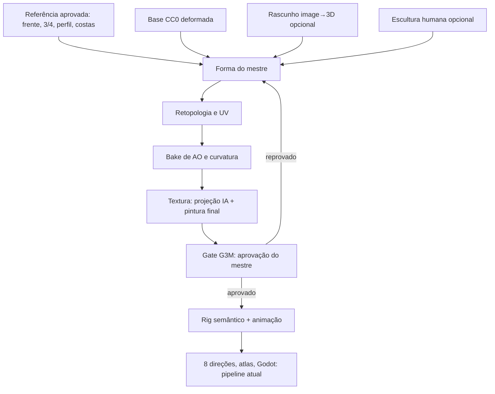

# Auditoria crítica de fidelidade visual

**Data:** 2026-11-06  
**Escopo:** Guardião da Floresta contra a folha de referência fornecida  
**Veredito:** resultado **reprovado** (decisão do usuário, registrada no gate G9 como `REJECTED`)  
**Estado desta entrega:** diagnóstico e proposta. Nenhuma mudança estrutural foi feita.

Evidências em `docs/audit/evidence/`. Script reproduzível: `scripts/audit_visual.py`.

---

## 1. Diagnóstico da implementação atual

### Como o personagem foi construído

**100% geometria procedural simplificada.** Não há modelo feito por artista, malha gerada por IA nem textura. Todo o visual sai de 448 linhas de Python em `blender/scripts/ics_blender/components.py` e `geometry.py`.

| Parte | Implementação real | Fato medido |
|---|---|---|
| Corpo | 1 tronco por anéis + cápsulas cônicas nos membros, unidos por remesh de voxels | 9.984 vértices sem fluxo de arestas; sem mãos, dedos, músculos ou clavícula |
| Cabeça | Elipsoide com queixo afunilado | 11.560 vértices, quase sem forma; sem nariz, maçãs do rosto ou mandíbula |
| Rosto | 9 elipsoides colados na frente | Sem pálpebras, sem íris desenhada, sem expressão |
| Cabelo | Elipsoides + tubos + remesh | 12.860 vértices, a maior malha, e continua sendo uma "touca" |
| Roupa | Túnica de revolução (uma casca) | 468 vértices; uma única camada real |
| Pés e mãos | Elipsoide e cápsula | Sem dedos, sem sandália |
| Materiais | Cor sólida + degraus toon | **0 texturas, 0 mapas UV**, zero variação dentro de uma peça |
| Luz | 2 sóis + mundo uniforme | Sem oclusão de contato, sem luz de contorno, sem pintura de luz |
| Contorno | Casca invertida de 8 mm | Espessura mecânica e uniforme |
| Câmera | Ortográfica, 30° | Correta para o jogo; nunca avaliou apresentação |
| IA | **Nenhuma** | Fase 6 não iniciada; `ai_engine` vazio |

A escolha foi minha: gerar assets originais por código, para não depender de terceiros e provar a cadeia técnica. Serviu para esse fim. Porém, o cenário de teste virou, sem que ninguém decidisse isso, a biblioteca de arte do produto.

### O que funciona e deve ser preservado

O vertical slice técnico roda de ponta a ponta. Os testes automáticos cobrem contratos, oito direções (erro de projeção de 0,19 px), lado anatômico, rig, contato dos pés, exportação e reprodução no Godot 4.7.2 (48 telas conferidas contra o frame esperado).

> **Esses testes comprovam que o personagem é tecnicamente íntegro. Nenhum deles mede qualidade artística.**

---

## 2. Causas da baixa qualidade visual

### Experimento: a resolução não é a causa

| Medida (silhueta) | Referência | Atual a 5× | Sprite ref. | Sprite atual |
|---|---|---|---|---|
| Detalhe (gradiente médio de luminância) | **0,0405** | **0,0132** | 0,0340 | 0,0215 |
| Cores distintas (5 bits por canal) | **2.814** | **559** | 1.221 | 345 |
| Valor das sombras (luminância p5) | **0,08** | **0,18** | 0,08 | 0,18 |

Renderizado a 1280×1600, o modelo atual fica **pior**: a resolução expõe volumes vazios (`evidence/A_alta_resolucao.png`). Em escala de jogo, a diferença permanece (`evidence/B_escala_de_jogo.png`). As medidas são indicadores da distância, não um veredito artístico.

### Causas, por ordem de impacto

1. **Causa arquitetural:** o sistema tenta obter arte a partir de primitivas paramétricas. Primitivas produzem formas lisas por definição. A referência vive de planos, quebras de forma e assimetrias que não existem como parâmetros. Adicionar peças sobre esta base não resolve.
2. **Não existe camada de textura.** Sem UV não há onde pintar. Grande parte da referência é pintura: sombra de músculo, desgaste, grafismos, gradientes. Essa é a maior perda em escala de jogo.
3. **Não existe personagem mestre.** Partimos direto para animação e oito direções, sem aprovar um modelo em resolução de apresentação.
4. **A direção de arte nunca virou critério mensurável.** O perfil `pindorama_stylized_v1` descreve luz e contorno, não proporção, tratamento de forma ou valor. O doc 03 existe, mas nenhum gate o aplicava.
5. **Ordem dos gates.** G3 só confere se as peças existem. A revisão artística ficou em G9, no fim. O erro chegou ao Godot sem ser barrado.

### Limite de escopo que também pesou

A escala de produção do MVP dependia de uma biblioteca que ninguém fora o código iria produzir. Código escrito por um agente não substitui escultura por olhar treinado. Qualquer plano sério precisa dizer de onde vem a forma.

---

## 3. Matriz de diferenças

A referência tem duas proporções. O herói mede cerca de **4,5 cabeças** e os sprites cerca de **3,5**. O alvo precisa ser escolhido (decisão D2).

| # | Item | Existe hoje | Falta | Causa provável | Como corrigir | Como validar |
|---|---|---|---|---|---|---|
| 1 | Proporções | 3,1 cabeças; ombros estreitos; braços finos em A | Tronco em V, mãos grandes, pernas fortes, postura firme | Proporção definida por bebê chibi, não pela arte | Base CC0 deformada para a proporção-alvo; `BodyProfile` versionado | Sobrepor silhueta à referência na mesma vista; medir razões cabeça/ombro/mão |
| 2 | Anatomia | Tubos sem articulação | Clavícula, peitoral, abdômen, joelho, tornozelo, dedos | Remesh de cápsulas apaga estrutura | Base quad com anatomia; forma pintada + normal baked | Revisão em luz rasante; deformação nas poses sentinela |
| 3 | Rosto | Olhos grandes, sem expressão | Sobrancelha pesada, nariz, boca, pintura facial, olhar | Rosto feito de elipsoides | Cabeça esculpida; olhos e rosto em textura | Comparação na escala de rosto; teste de legibilidade a 48 px |
| 4 | Cabelo e acessórios | Touca + 1 tubo; 3 penas de tubo | Mechas por massa, coque, cocar, brinco, colar de dentes, aljava, arco | Sem kit de mechas; pena sem forma | Mechas por curvas convertidas em malha; penas como cartões pintados | Silhueta reconhecível sem cor |
| 5 | Roupas e camadas | Vestido liso, cinto, trim | Tanga recortada, faixa vermelha, ombreira de penas, braçadeiras, faixas cruzadas, sandália | Roupa modelada como casca única | Camadas por extração da superfície do corpo, com bordas recortadas | Contagem de camadas; teste de atravessamento em walk/run |
| 6 | Detalhe geométrico | 42.456 vértices mal distribuídos | Densidade onde a silhueta precisa | Remesh uniforme: cabelo com 27× os vértices da túnica | Retopologia dirigida; orçamento por parte | Relatório de orçamento; olho em wireframe |
| 7 | Texturas | 0 mapas, cor chapada | Pintura de forma, grafismo, desgaste | Sem UV nem etapa de textura | UV + bake AO/curvatura + projeção + pintura final | Mapa existe e é usado; métrica de detalhe na silhueta |
| 8 | Sombras e luz | 3 degraus, sombras claras (p5 0,18) | Sombras escuras e quentes, contato, recorte | Multiplicador uniforme; nenhuma oclusão | Luz pintada na textura + oclusão baked + rim controlado | Histograma de valor; consistência entre vistas |
| 9 | Silhueta | Bola sobre tubo com lança fina | Massa de penas, cabelo, arco e aljava que definem o personagem | Acessórios decorativos, não estruturais | Projetar a silhueta antes do detalhe | Teste em preto: reconhecível por pessoas |
| 10 | Acabamento | Boneco vetorial limpo | Traço variável, pintura digital | Pipeline termina no material chapado | Contorno por máscara + traço pintado | Revisão humana lado a lado, nas duas escalas |

### Observações sobre a própria referência

- **É uma ilustração plana.** Traz luz pintada, contorno à mão e pequenas mudanças entre vistas. Um render 3D não vai copiá-la pixel a pixel. O alvo correto é a mesma identidade e o mesmo nível de acabamento.
- **É internamente inconsistente:** altura em cabeças varia; a linha Idle mostra uma vista de costas; ela carrega arco e lança; e penas e braçadeiras mudam entre sprites. Isso é o tipo de falha que o doc 16 prevê e o motivo para manter 3D como fonte de verdade.
- **Proveniência desconhecida.** O gate G2 exige origem e licença. Não sei se ela foi gerada por IA nem com qual ferramenta.
- **Referência cultural.** Cocar de penas, pintura facial e colar de dentes pedem cuidado. O doc 03 §4 exige identificar a inspiração específica ou tratar como fantasia original declarada, sem atribuir a um povo real.

---

## 4. Pesquisa das tecnologias alternativas

Limite local: **RTX 5060 com 8 GB**, 32 GB de RAM, Windows 11, Blender 5.2.3. Lista completa de URLs em `docs/research/RESEARCH_LOG.md`.

| Abordagem | Opção | Licença (verificada) | Hardware (fonte oficial) | Encaixe | Parecer |
|---|---|---|---|---|---|
| Base modular | **Blender Human Base Meshes v1.4.1** | CC0 | Blender 4.2+ | Quad, UV, volumes fechados, com bases estilizadas | **Adotar** |
| Base modular | Quaternius Universal Base Characters | CC0 na página do pack | Sem exigência | Rig humanoide; estilo próprio | Reserva. Há relato de nova licença QAL: conferir por pack |
| Rig | Rigify (oficial) | Rig gerado funciona sem o add-on | Blender | Só cria o rig; não pesa a malha | Manter nosso rig semântico; Rigify só se precisarmos de controles para animador |
| Image→3D | **Hunyuan3D 2.0** | Comunidade Tencent: **exclui UE, Reino Unido e Coreia do Sul**; limite de 1M MAU; não usar saídas para treinar outro modelo | **6 GB só forma**, 16 GB com textura; Windows | Forma cabe aqui, textura não | Testar como **rascunho de forma**, se D4 liberar |
| Image→3D | Hunyuan3D 2.1 | Mesma família de termos | 10 GB forma, 29 GB total | Não cabe | Descartar localmente |
| Image→3D | **TRELLIS.2** | MIT (com dependências próprias) | **24 GB; testado só em Linux** | PBR em GLB; não cabe localmente | Apenas com GPU na nuvem, se autorizado |
| Image→3D | TripoSR / TripoSG / InstantMesh | MIT / MIT / Apache-2.0 | A medir | Qualidade a provar | Reserva local |
| Personagem IA | CharacterGen / StdGEN | Código Apache-2.0; **StdGEN declara checkpoints só para pesquisa**; treino com dados VRoid | A medir | Alvo anime, sem uso comercial claro | **Não usar em produção** |
| Serviço pago | Meshy | Termos: plano pago dá propriedade da saída; gratuito é CC BY; uso para treino salvo opt-out; saída pode não ter proteção de PI | Nuvem | Remesh e rig inclusos | Opção de corte de tempo; exige aprovar **custo e envio da imagem** |
| Serviço pago | Tripo | **Termos oficiais não acessados** (HTTP 403) | Nuvem | Equivalente | Sem decisão até ler os termos |
| Retopologia | QRemeshify | GPL-3.0; add-on Blender | CPU | Sem dependência | **Adotar como ferramenta**; não entra no produto |
| Autorig IA | UniRig | Código MIT; **licença dos pesos não declarada** no README | 8 GB; CUDA | Não garante nomes semânticos | Só para malhas com topologia estranha; pelos sempre validados pelo nosso rig |
| Textura IA | **StableGen + ComfyUI + SDXL** | Add-on GPL-3.0; alguns modelos não comerciais | **~8 GB para SDXL**; Blender 5.1+ | Projeta do Blender e faz bake em UV | **Adotar para testes**; escolher modelo com licença comercial |
| Textura manual | Pintura no Blender + bake | Software livre | Local | Maior controle | **Etapa final obrigatória** |
| NPR | Goo Engine e branch NPR | Fork em Blender 4.1; branch experimental | — | Fora da versão fixada | Rejeitar; manter Shader to RGB e EEVEE |
| Animação | Mixamo | Termos não confirmados (PDF ilegível pela ferramenta) | Nuvem | Exigiria retarget | Sem decisão |

**Conclusões da pesquisa**

1. Nenhuma ferramenta entrega personagem pronto para jogo. Toda rota por IA exige retopologia, UV, rig e correção.
2. O melhor uso de IA aqui é em **texturização projetada** e **folha de referência**, onde 8 GB bastam e o controle humano continua.
3. A geração de malha por IA fornece forma de partida, não asset final. Isso confirma os docs 13 e 16.
4. O maior ganho de licença e qualidade por esforço é trocar a origem da forma, adotando uma base CC0 com topologia real.

---

## 5. Arquitetura de geração recomendada

**Pipeline de Personagem Mestre.** Cada personagem nasce de um mestre aprovado, antes de qualquer animação.

**Personalização sem perder qualidade.** A biblioteca deixa de ser geradores Python e passa a ser **assets aprovados com `asset.json`**: corpos com a mesma topologia e UV (variantes por shape key), peças por camada ajustadas a esse corpo, e conjuntos de textura e paleta. O `CharacterSpec` continua escolhendo componentes. Um personagem novo reaproveita o mestre, em vez de exigir arte do zero.

### Reaproveitamento

| Componente | Decisão |
|---|---|
| Contratos, jobs, cache por etapa, worker Blender | **Manter** |
| `DirectionConvention`, câmera, projeção | **Manter** |
| Rig semântico e validadores | **Manter**, reajustando posições ao novo corpo |
| Gerador de animação e validadores temporais | **Manter**, recalibrando passada e tolerâncias |
| Atlas, QA de imagem, exportação, Godot | **Manter** |
| `geometry.py`, `components.py` | **Rebaixar** a fixtures de teste, fora da biblioteca de produção |
| `materials.py`, perfil de arte | **Substituir** por material com texturas |

---

## 6. Mudanças necessárias na documentação

Propostas, ainda não aplicadas:

| Doc | Mudança |
|---|---|
| 00 | Nova decisão: Personagem Mestre obrigatório; biblioteca é de assets aprovados |
| 03 | Regras mensuráveis de proporção, forma, valor, textura e acabamento; duas escalas de avaliação |
| 05 | Novo módulo Master Asset; Character Builder passa a instanciar assets |
| 06 | Contratos `MasterCharacter` e bloco `art_quality` no `asset.json`; UV e textura obrigatórios |
| 07 | Etapa de mestre entre conceito e rig |
| 11 | Nova fase 1A antes do rig; Fase 1 redefinida |
| 12 | Critérios visuais de aceite com comparação lado a lado |
| 13 | Riscos: licença de modelos, envio de referências, dependência de artista |
| 19 / 23 | Testes VIS-001…; métricas de referência como indicadores |
| 20 | Novo gate G3M antes de G4 e G5; rejeição sempre bloqueia export |

---

## 7. Plano de correção priorizado

Sem prazos, conforme a política do roadmap. Cada passo só avança com a saída aprovada.

| Prioridade | Passo | Saída | Quem decide |
|---|---|---|---|
| **P0** | Congelar novas animações, famílias e UI | Registro em STATUS | Já decidido |
| **P0** | Resolver D1–D5 (abaixo) | Decisões registradas | Usuário |
| **P1** | Criar folha de quatro vistas coerentes a partir da referência | Referência limpa para G2 | Usuário aprova |
| **P1** | Bake-off de forma, sem textura: **Rota A** base CC0 deformada; **Rota B** image→3D como rascunho, se autorizada | Quatro vistas em argila, cada rota | Usuário escolhe |
| **P1** | Retopologia e UV da rota vencedora | Malha limpa + relatório | Automático + revisão |
| **P2** | Textura: bake + projeção + pintura final | Mestre pintado | Usuário aprova |
| **P2** | Material novo e luz | Render nas duas escalas | Usuário aprova |
| **P3** | Ajustar rig e rodar poses sentinela no mestre | G4 no mestre | Automático + revisão |
| **P3** | Religar animação, render e Godot | Pacote novo | Automático + revisão |
| **P4** | Generalizar em kit: segundo personagem usando o mesmo mestre | Prova de personalização | Usuário aprova |

**Critério de parada:** se a Rota A e a Rota B não alcançarem silhueta e rosto aceitáveis, a conclusão honesta é que o mestre precisa de escultura humana. Só então peço essa decisão com base em evidência.

---

## 8. Protótipo proposto e critérios de aprovação

**Entrega:** um personagem estático, sem animações: **frente, três quartos, perfil e costas**, do mesmo arquivo `.blend`, com a câmera registrada. Cada vista em resolução de apresentação (mínimo 1600 px de altura) e em escala de jogo, ao lado da referência.

**Elementos essenciais a manter:** rabo de cavalo alto com penas vermelhas, brancas e laranja; pintura facial vermelha; colar de dentes com contas; ombreira de penas; braçadeiras trançadas; cinto com disco; tanga recortada com faixa vermelha; faixas cruzadas nas pernas; sandálias; arco e aljava nas costas.

### A. Validação técnica

Automática, bloqueante:

- geometria manifold nas partes fechadas, sem faces degeneradas, escala e origem corretas;
- UV sem sobreposição indevida e densidade de texel dentro do orçamento;
- mapas de textura presentes e usados por todos os materiais;
- orçamento de vértices por parte, documentado;
- mesmo hash de `.blend` nas quatro vistas;
- licença e origem registradas para cada asset.

### B. Validação visual

Revisão humana, bloqueante. Métricas apenas orientam.

- comparação lado a lado com a referência nas duas escalas;
- silhueta reconhecível só em preto;
- proporções dentro da faixa aprovada em D2;
- rosto legível e expressivo nas duas escalas;
- pelo menos cinco materiais visualmente distintos;
- acabamento de pintura digital, sem aparência de boneco liso;
- sombras e identidade coerentes entre as quatro vistas;
- indicadores: detalhe ≥ 0,030, cores ≥ 1.500 e sombra p5 ≤ 0,12 na resolução de apresentação (metas iniciais, a calibrar).

> Nenhuma métrica aprova sozinha. Aprovar exige registro em G3M com revisor, data e hash.

### C. Validação funcional

Prova mínima, sem produzir clips novos:

- rig semântico aplicado com RIG-001 a RIG-004 aprovados;
- poses sentinela sem atravessar roupa de forma grave;
- uma pose de corrida extrema, renderizada;
- exportação GLB reimportada sem perda;
- um frame nas oito direções sem corte em 256×320, ou novo canvas justificado.

---

## 9. Decisões necessárias do usuário

| ID | Decisão | Recomendação |
|---|---|---|
| D1 | Qual a origem e licença da referência? | Informar antes de usá-la como G2 |
| D2 | Alvo de proporção: herói (~4,5 cabeças) ou sprite (~3,5)? | Sprite, pois é o que aparece no jogo |
| D3 | Inspiração: fantasia original ou povo específico? | Fantasia original declarada |
| D4 | Pode enviar a referência a serviços externos e usar Hunyuan3D, ciente da exclusão de UE, Reino Unido e Coreia do Sul? | Testar localmente só se o MMORPG não depender desses mercados, após leitura jurídica |
| D5 | Há orçamento para GPU em nuvem, serviço pago ou artista 3D? | Decidir depois do bake-off |
| D6 | Equipamento final do personagem: arco, lança ou ambos? | Arco e aljava, como no herói; lança como segunda variante |

---

## 10. Limitações desta auditoria

- As medidas compararam ilustração com render em recortes próprios: indicam distância, não qualidade.
- As proporções da referência são estimativas visuais em imagem 2D.
- Requisitos de VRAM são os declarados pelos projetos; nada foi instalado nem executado aqui.
- Não li os termos do Tripo e do Mixamo; licenças aqui resumidas não são parecer jurídico.
- Nenhuma afirmação de qualidade profissional é feita sobre o estado atual ou a arquitetura proposta.
